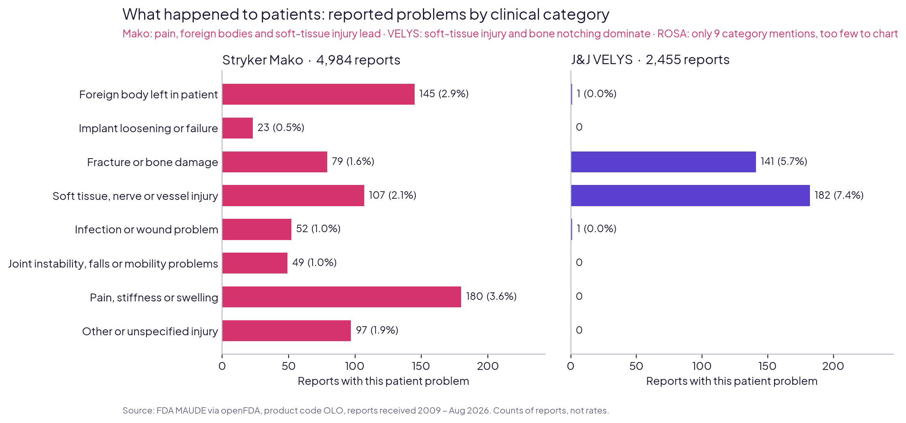
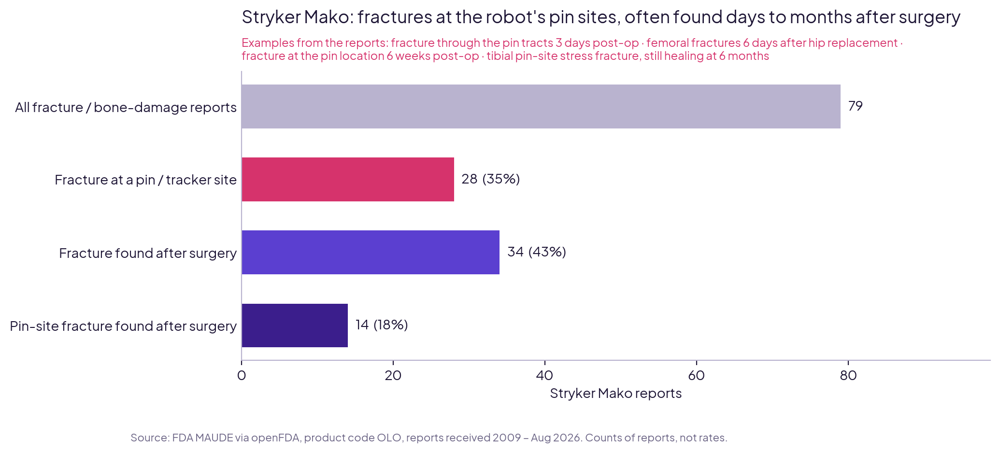

# Robotic Knee & Hip Replacement – What 7,539 FDA Reports Reveal

**Stryker Mako · J&J DePuy VELYS · Zimmer Biomet ROSA, read by a physiotherapist**

*Dr. Muhammad Ali, DPT · Medical Researcher and Data Analytics*

---

## The question

What problems are reported for robotic-assisted joint replacement systems, what happens to patients, and which of these problems can better surgical awareness, training and rehabilitation help prevent?

**Built for:** orthopaedic device companies, hospital orthopaedic and rehabilitation teams, clinical specialists.

## Key findings

| # | Finding | Why it matters |
|---|---|---|
| 1 | **7,539 reports** for the three robots (Mako 4,984 · VELYS 2,455 · ROSA 100), out of 20,634 FDA reports for product code OLO | Every count is verified against the FDA's own totals |
| 2 | **No deaths** reported for any of the three robots | A strong safety signal |
| 3 | **About 1 in 8 reports** describes an actual patient problem (Mako 12.2% · VELYS 12.9% · ROSA 9.0%) | Most reports are device malfunctions without patient harm |
| 4 | **Mako:** a part detaching is the top device problem (28% of reports), linked to **145 reports of a foreign body left in the patient**; the largest patient category is **pain, stiffness or swelling (180)** | Instrument checks and post-operative pain assessment |
| 5 | **Mako pin-site fractures:** of 79 fracture / bone-damage reports, **28 (35%)** describe a fracture at a pin or tracker site and **34 (43%)** a fracture found **after surgery**, days to months later | These fractures appear during walking and rehabilitation, when a physiotherapist sees the patient |
| 6 | **VELYS:** "device slipped" appears in **59%** of reports; patient problems are **soft-tissue injury (182)** and **bone damage (141)**, mostly **notching** of the femur | Notching is a known risk factor for later fractures above the knee implant |
| 7 | **ROSA:** 100 reports, 9 with a patient problem | Too few to show a pattern |

### What this means for rehabilitation
- **Localised pain at a pin site** during early loading should be checked, not assumed to be normal post-operative pain.
- **Progress weight-bearing carefully**, especially in patients with weaker bone; **fall prevention** is part of fracture prevention.
- When the surgeon reports **femoral notching**, the rehabilitation team should know.

## Charts

## How it was done, and how accuracy is proven

Every step ends with **gates**: automatic checks that stop the notebook if a number does not match its source.

1. **Download:** all 20,634 FDA MAUDE reports for product code OLO, via the openFDA API. *Gates:* downloaded = FDA total, no duplicates, saved file complete.
2. **Table:** one row per report. *Gate:* deaths, injuries, malfunctions, other and blank counts equal the FDA's own count, requested separately.
3. **Select the three robots** by brand and manufacturer name; spine and brain systems excluded. *Gates:* no report in two groups, groups add up to the total; remaining names reviewed manually.
4. **Problems:** the FDA's own coded device and patient problem terms; "no harm" and "no information" terms separated.
5. **Clinical categories:** patient problems grouped into 7 clinical categories, reviewed by a physiotherapist (instability/falls and implant loosening added after review).
6. **Fracture stories:** event descriptions searched for pin/tracker-site fractures, notching and fractures found after surgery; keyword rules tightened after reading examples.
7. **Results** saved and re-read (gate: identical), charts checked against the saved tables, every headline number recalculated in the final step.

## Files

| Folder | Contents |
|---|---|
| [`notebooks/`](notebooks) | `robotic_joint_fda_01_download_and_verify.ipynb` – download, verification, robot selection · `robotic_joint_fda_02_problems_and_patient_impact.ipynb` – problems, clinical categories, fractures, charts, findings |
| [`figures/`](figures) | Charts (PNG) |
| [`data/clean/`](data/clean) | `robot_reports.csv` (7,539 reports) · `clinical_categories.csv` · `top_device_problems.csv` · `fracture_patterns.csv` |
| [`data/raw/`](data/raw) | `olo_reports_raw.jsonl.gz` – all 20,634 reports exactly as downloaded |

**Tools:** Python (pandas, requests, matplotlib) in Google Colab.

## Limitations
- **Counts, not rates.** The FDA does not publish how many operations each robot performs, so the robots cannot be ranked by safety.
- **MAUDE reports are unverified and incomplete.** Not every event is reported, and companies report differently (e.g. VELYS reports many small part malfunctions).
- **ROSA is a minimum.** Some Zimmer accessory reports (pins, tools) do not say which system they were used with.
- **Pin-site and after-surgery patterns** come from keyword searches of report text, checked by reading examples – not a validated coding system.

## Data source
U.S. Food and Drug Administration, MAUDE adverse-event database, accessed through [openFDA](https://open.fda.gov/apis/device/event/) (product code OLO, database updated 2026-09-22). openFDA notes that its data is unvalidated and should not be used for medical decisions.

---

**Contact:** muhammadali17598@gmail.com · +966 57 087 8136
